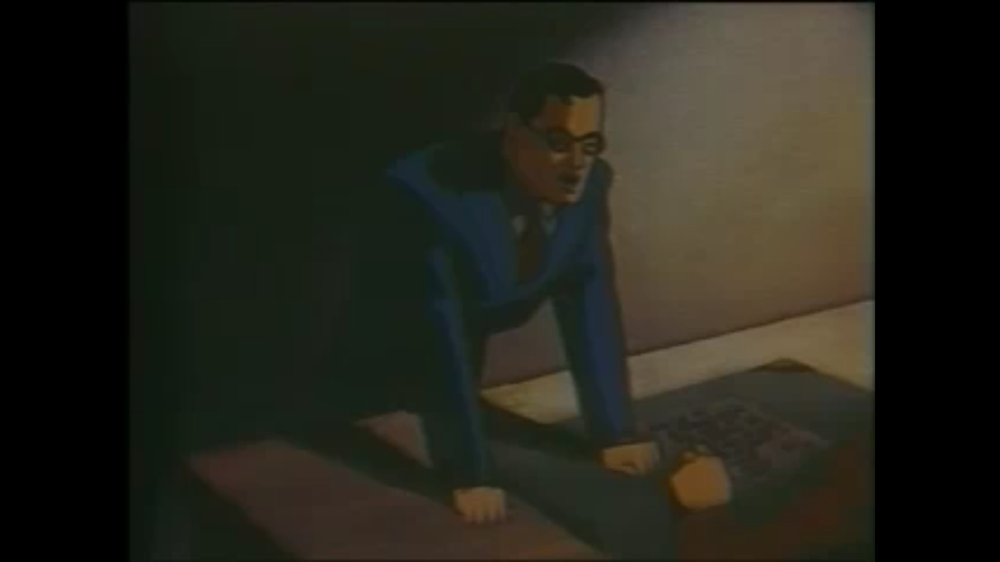

# Retro Airwaves

Retro Airwaves is a Kodi-native alternative to [Spelunkr](https://spelunkr.tv/app). It runs four continuously scheduled channels of archival films: Oddities, Space, Toons, and In Motion. It uses its own schedule and catalog; it does not call Spelunkr, require an account, or run a server.

## Install on Kodi

1. Download `script.retro.airwaves-1.1.0.zip` from the [latest release](../../releases/latest). Use the add-on ZIP, not GitHub's automatic source archive.
2. In Kodi, open **Add-ons → Add-on browser → Install from zip file** and pick the downloaded ZIP. If Kodi requires **Unknown sources**, enable it only long enough to install the ZIP.
3. Open **Retro Airwaves** from **Program add-ons**. If your skin supports Home shortcuts, add `RunAddon(script.retro.airwaves)`.

Tested on Kodi 20.5 (Nexus). The add-on uses Kodi's player to stream from the Internet Archive. No account, separate server, or IPTV configuration is required. The ZIP does not change your skin or existing Live TV setup.

## Use the guide

Use **Up/Down** to select a channel, **OK** to tune in at the scheduled point, and **Stop** to return to the guide. **Back** closes the guide. The four channels loop independently and show their current and upcoming programs in local time.

Playback example: [Superman (1941)](https://archive.org/details/superman_1941), marked public domain by the Internet Archive item.

## Develop

The lineup is in `script.retro.airwaves/resources/channels.json`. Each item links to its rights and metadata at `https://archive.org/details/<item>`. Program durations are in seconds from the exact MP4 in each record. Editing the durations or order changes the UTC schedule for that channel.

Run `python3 -B check_schedule.py` to check cutovers, wraparound, and URL encoding. When packaging, put the `script.retro.airwaves/` folder at the ZIP root and include a copy of `LICENSE` in that folder.

## Credits

Inspired by [Spelunkr](https://spelunkr.tv/) and vintage cable guides. The app, artwork, lineup, and schedule are independent; it uses no Spelunkr code or assets. Films stream from the Internet Archive and are not bundled. Rights information for each film is on its Archive item page.

Original code and guide artwork are provided under the [MIT License](LICENSE). The playback screenshot shows third-party archival footage and is not covered by that license.

