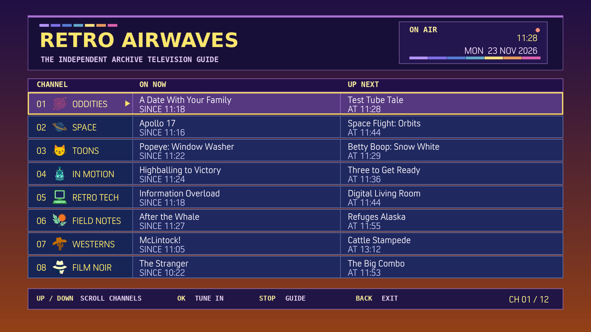

# Retro Airwaves

Retro Airwaves is a Kodi-native alternative to [Spelunkr](https://spelunkr.tv/app). It has 12 independently scheduled channels of archival film and television. It does not call Spelunkr, require an account, or run a server.

[See the guide scrolled to channels 5–12](screenshots/guide-scrolled.jpg).

## Install on Kodi

1. Download the `script.retro.airwaves-*.zip` add-on package from the [latest release](../../releases/latest). Do not use GitHub's automatic source archive.
2. In Kodi, open **Add-ons → Add-on browser → Install from zip file** and pick the downloaded ZIP. If Kodi requires **Unknown sources**, enable it only long enough to install the ZIP.
3. Open **Retro Airwaves** from **Program add-ons**. If your skin supports Home shortcuts, add `RunAddon(script.retro.airwaves)`.

Tested on Kodi 20.5 (Nexus). The add-on uses Kodi's player to stream directly from the Internet Archive and Wikimedia Commons. No account, separate server, or IPTV configuration is required. The ZIP does not change your skin or existing Live TV setup.

## Use the guide

The guide shows eight channels at a time. Use **Up/Down** to scroll the full lineup, **OK** to tune in at the scheduled point, and **Stop** to return to the guide. **Back** closes the guide. Each channel shows its current and upcoming programs in local time.

The lineup includes Oddities, Space, Toons, In Motion, Retro Tech, Field Notes, Westerns, Film Noir, Sci-Fi, Silent Film (comedy), Newsreels, and Classroom.

Playback example: [Superman (1941)](https://archive.org/details/superman_1941), marked public domain by the Internet Archive item.

## Develop

The lineup is in `script.retro.airwaves/resources/channels.json`. For Internet Archive entries, see `https://archive.org/details/<item>` for the source and rights information. Direct streams instead carry `url` and `source_page` fields. Use the exact stream duration in seconds; editing durations or order changes the UTC schedule for that channel. Channel badges are 96×96 indexed PNGs under `resources/skins/default/media/channels/`.

Run `python3 -B check_schedule.py` to check cutovers, wraparound, and URL encoding. When packaging, put the `script.retro.airwaves/` folder at the ZIP root and include a copy of `LICENSE` in that folder.

## Credits

Inspired by [Spelunkr](https://spelunkr.tv/) and vintage cable guides. Selected titles overlap with Spelunkr's public listings, but the artwork, schedule, and app are independent. Retro Tech streams unmodified [Computer Chronicles](https://archive.org/details/computerchronicles) episodes under their item-level [CC BY-NC-ND 2.0](https://creativecommons.org/licenses/by-nc-nd/2.0/) licenses. No footage is bundled; see the source listing for each film.

Original code and guide artwork are provided under the [MIT License](LICENSE). The playback screenshot shows third-party archival footage and is not covered by that license.

